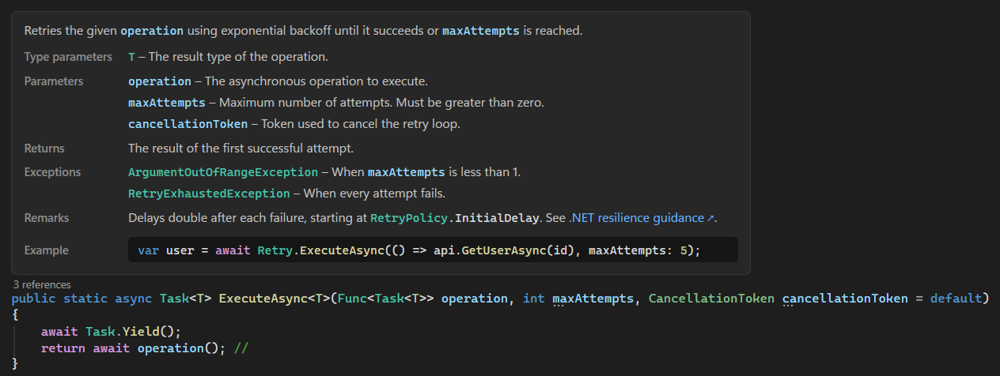
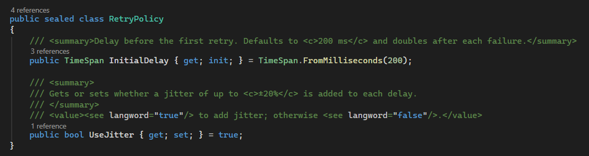
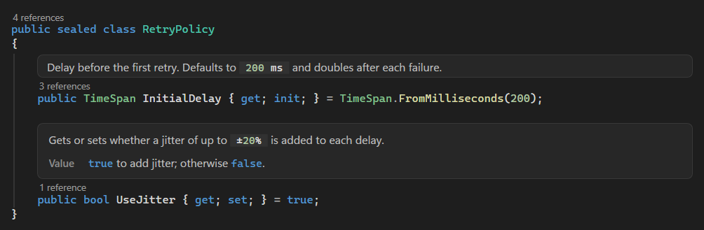
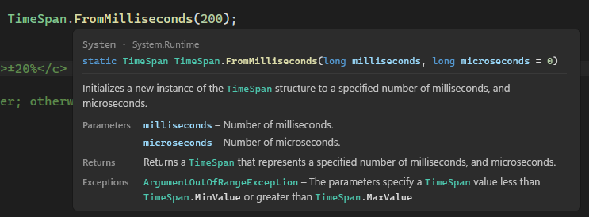
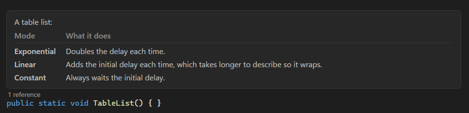
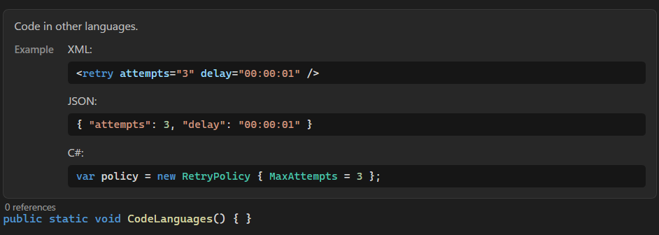

# Rendered Doc Comments

A Visual Studio extension that shows C# `///` documentation comments as clean, readable cards, and switches them back to raw text whenever you want to edit them.

- **Readable comments.** The summary, then labelled sections for parameters, return value, exceptions, remarks and examples, in your editor's fonts and theme colours.
- **Clickable links.** Click a type or member to go to its definition, hover it to see its signature. Web links open in your browser.
- **Coloured code.** Code in comments uses your theme's syntax colours, for C# and also XML, XAML, HTML and JSON.
- **The full tag set.** Lists, tables, notes, headings and the common HTML tags all render properly; see [Supported tags](#supported-tags).
- **`<inheritdoc/>` filled in**, from your own code or from .NET's documentation.
- **Quick documentation.** `Ctrl+Shift+F1` shows the rendered documentation of any name at the cursor, .NET's included, in a popup. Optionally on hover too.
- **Everywhere you read code.** Cards also appear in Peek Definition and side-by-side diffs.
- **Your files are never changed.** Cards are drawn over the editor; the comment text stays exactly as you wrote it.

### Before and after

The same code, with its comments as written:

And with Rendered Doc Comments:

## Requirements

Visual Studio 2026, or Visual Studio 2022 version 17.14 or later, with C# files.

## Installing

1. Download `RenderedDocComments.vsix` from the [latest release](https://github.com/BillyParkerr/Rendered-Doc-Comments/releases/latest).
2. Double-click it and follow the installer. It asks you to close Visual Studio if it's open.

To update, install a newer release the same way. To uninstall, use **Extensions > Manage Extensions** in Visual Studio.

You can also build it from source: see [docs/DEVELOPMENT.md](docs/DEVELOPMENT.md).

## Using it

Open a C# file: documentation comments show as cards.

| To | Do this |
|---|---|
| Switch a comment between card and raw text | Click its icon in the margin next to the line numbers: a pencil on a card, a book on a raw comment |
| Switch the comment at (or just above) the cursor | `Ctrl+M, Ctrl+Q` |
| Switch every comment in the file | `Ctrl+M, Ctrl+W` |
| Show the documentation of the name at the cursor | `Ctrl+Shift+F1`; press it again, or `Esc`, to close |
| Go to the definition of a type or member in a card | Click it (hover it to see its signature first) |
| Fold or unfold a comment | The arrow in the outlining margin, or `Ctrl+M, Ctrl+M` |
| Copy text from a card | Drag over it, then `Ctrl+C` or right-click > Copy |

The switching and quick documentation commands are also in **Tools > Rendered Doc Comments**. To use other keys, rebind them in Visual Studio's keyboard settings (search for `RenderedDocComments`); the quick documentation shortcut can also be set in the extension's [options](#options).

### Good to know

- Comments you switch to raw text stay raw the next time you open the file, even after restarting Visual Studio. Each comment is recognised by the declaration below it, so editing the file or the comment doesn't lose your choice; renaming the declaration does.
- A new `///` comment you're typing stays raw until you switch it to a card.
- Find opens a comment to show a match; the card comes back when you move to another line.
- The arrow keys and Page Up/Page Down move past cards rather than into them. Clicking beside a card puts the cursor on the declaration below it.
- Outlining folds and unfolds whole comments, cards included, as in plain Visual Studio. Unfolding brings back whichever view the comment had.
- In a side-by-side diff, a comment that's the same on both sides is a card on both. A comment that changed stays raw, so you can see what changed. Inline diffs stay raw.
- Links need the file to be part of a C# project, so Roslyn can resolve them. Cards in a loose file still render.

## Quick documentation

`Ctrl+Shift+F1` shows a popup with the rendered documentation of the name at the cursor: a type, method, property, constructor (`new Widget()` and attributes), `var`, a keyword type like `string`, a parameter, a local, or a cref inside a doc comment.

- **What it shows:** the namespace (and the assembly, for .NET and NuGet types), the signature in your theme's code colours, then the documentation laid out as on a card. A parameter shows its description from its method's `<param>`. Something without documentation shows just its signature.
- **Where the documentation comes from:** your code's comments, with `<inheritdoc/>` filled in, or the documentation files that come with .NET and NuGet packages. An override or interface implementation without a comment of its own shows the documentation of what it overrides or implements.
- **Links:** click a type in the signature or a link in the documentation to show that symbol in the same popup, and the **←** link at the top (or the mouse's Back button) to go back. Click the symbol's own name to go to its definition.
- **Closing:** `Esc`, the shortcut again, moving the cursor, typing, or clicking elsewhere. You can select and copy text in the popup.

### On hover

Turn on **Show cards on hover** in the options to see the popup when you hover a name, in place of Visual Studio's own tooltip.

- The popup stays while the mouse is over the name, over the popup, or on its way between them, and closes as soon as it moves elsewhere. Once you click in the popup, it stays open like a `Ctrl+Shift+F1` popup.
- Visual Studio's own tooltip still shows over error and warning squiggles (so you see the message), over things that aren't names, and for `Ctrl+K, Ctrl+I`.

## Options

**Tools > Options > Rendered Doc Comments**. In Visual Studio 2026 they're in the Settings window (or search there for "Rendered Doc Comments"); in Visual Studio 2022 they're on the classic **Rendered Doc Comments > General** page. Changes apply straight away.

| Option | What it does |
|---|---|
| Render comments when a file opens | On by default. Turn it off to open every comment as raw text; then the comments you switch to cards are the ones remembered. |
| Show gutter icon | The pencil and book icons next to the line numbers. |
| Maximum card width | In pixels. Cards also shrink to fit the editor window. |
| Text font, Text size (%) | For the text in cards. Code keeps the editor font. |
| Show cards on hover | Off by default. See [On hover](#on-hover). |
| Quick documentation shortcut | `Ctrl+Shift+F1` by default. For example `Ctrl+Q`, or `Ctrl+K, Ctrl+Q` for two keys in a row; empty for none. Changing it sets Visual Studio's own key binding for the command. If you rebind it in the keyboard settings instead, this setting shows the new keys after Visual Studio restarts. Keys Visual Studio doesn't understand are reported in the status bar. |

## Supported tags

Every C# documentation tag, plus the HTML ones often used in doc comments. For example, a table list, and code blocks in other languages:

| Tag | On the card |
|---|---|
| `
` | The text at the top. Text outside any section counts as summary too. |
| `<typeparam>`, `<param>`, `<returns>`, `<value>`, `<exception>`, `<permission>`, `<remarks>`, `<threadsafety>`, `<example>`, `<seealso>` | Labelled sections, always in this order. Empty ones are left out. |
| `<inheritdoc/>` | The inherited documentation, with an "Inherited from" link. See below. |
| `<para>`, `
`, ` ` | Paragraphs and line breaks. |
| `<list type="bullet">`, `<list type="number">`, `<ul>`, `<ol>`, `<li>` | Bulleted and numbered lists, which can be nested. A `<term>` is shown in bold before its description. |
| `<list type="table">` | A two-column table, with `<listheader>` as its header row. |
| `<note type="…">` | A callout with a coloured bar: Note, Tip, Important, Warning, Caution, Security, or Note to implementers / callers / inheritors. |
| `<code>`, `<pre>` | Code blocks. `<code>` is C# unless its `language` (or `lang`) attribute says otherwise: XML, XAML and HTML are coloured as markup, JSON, JavaScript, TypeScript, Java and C++ with the C# colours, and anything else plain. `<pre>` is plain unless it names a language. |
| `<c>`, `<tt>` | Inline code, coloured as C#. |
| `<see cref>`, `<seealso cref>` | Links to the type or member. |
| `<see href>`, `<a href>` | Web links. |
| `<see langword>`, `<paramref>`, `<typeparamref>` | The keyword or name, in its code colour. |
| `<b>`, `<strong>`, `<i>`, `<em>`, `<u>`, `<s>`, `<strike>`, `<del>`, ``, ``, `` | As in HTML. |
| `<h1>` to `<h6>` | Headings. |
| `<threadsafety static instance>` | In words, such as "Static members are safe to use from several threads at once; instance members aren't." |
| `<include file path>` | A note naming the file. The included documentation isn't read. |
| Any other tag at the top level, such as `<since>` | A section of its own, named after the tag. |
| `<overloads>`, `<filterpriority>`, `<exclude>`, `<preliminary>` | Not shown: they're instructions for documentation tools. |

### `<inheritdoc/>`

- It inherits from the member its `cref` names; otherwise from the overridden member, the implemented interface member, or (for a class) the base class. Chains of `<inheritdoc/>` are followed.
- Documentation for .NET members comes from .NET's documentation files.
- The comment's own sections win over inherited ones, and only parameters the member actually has are inherited.
- `path` picks part of the inherited documentation, as the C# compiler does: `<inheritdoc path="/summary"/>`.
- An `<inheritdoc/>` inside a section, such as inside `
` or a `<param>`, is replaced by the matching part of the inherited documentation.
- When the inherited documentation is in another file, editing that file updates the card about a second after you stop typing.

## Known limitations

- On a card's first line, Visual Studio draws the outlining arrow as collapsed (**>**), and shows it even when arrows only appear on hover. Visual Studio draws that arrow from its own internal state, which extensions can't change. Clicking it still folds the comment as expected.
- `<include>` documentation isn't loaded; the card names the file instead.
- `` and `
` aren't shown.

## Contributing

Bug reports and pull requests are welcome. [docs/DEVELOPMENT.md](docs/DEVELOPMENT.md) explains how to build, run and test the extension, and how the code is organised.

## License

[MIT](LICENSE)
